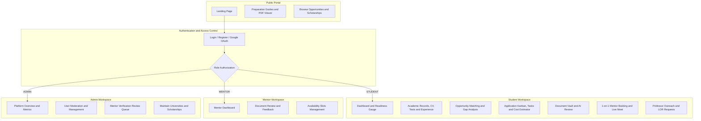

# 🎓 ShimanaPeriye — PUB GradPath
### Higher-Study Discovery & Application Workspace

[](https://nextjs.org/)
[](https://react.dev/)
[](https://tailwindcss.com/)
[](https://www.typescriptlang.org/)
[](https://turbo.build/pack)

---

## 📌 Project & Team Information

- **Track:** Track D — Academic and EdTech Platforms
- **Problem ID & Title:** **D2. PUB GradPath — Higher-Study Discovery and Application Workspace**
- **Project Name:** **ShimanaPeriye**
- **Team Name:** *Semicolon Survivors*

### 👥 Team Members
| Name | Student ID | Role / Responsibility |
| :--- | :--- | :--- |
| **Md. Zisan Ul Haque** | *0322410105101037* | Team Lead & Full-Stack Developer |
| **Afsana Nur Labonno** | *0322410205101053* | Frontend Developer |
| **Al Amin Sarder** | *0322410105101011* | UI/UX Designer & Video Editor |
| **Zahin Rahman Rufaida** | *03225205101089* | Researcher |
| **Mst.Nusrat Ananna** | *03225205101078* | Researcher |

---

## 🎥 Demo Video

> 🎬 **Watch the Full Product Walkthrough Demo:**  
> **[▶️ Click to Watch Demo Video on YouTube](https://youtu.be/CDkUl5r1YLg?si=59AoiJ2IzGpk2qzY)**  
> *(Unlisted, accessible to anyone with the link — showcases end-to-end Student, Mentor, and Administrator workflows)*

---

## 🌐 Deployed Application & Repository Links

- **Frontend Repository:** [https://github.com/ZisanUlHaque/shimana-periye-frontend](https://github.com/ZisanUlHaque/shimana-periye-frontend)
- **Backend Repository:** [https://github.com/ZisanUlHaque/shimana-periye-backend](https://github.com/ZisanUlHaque/shimana-periye-backend)
- **Live Deployed URL:** [https://shimanaperiye-frontend.vercel.app](https://shimanaperiye-frontend.vercel.app)

---

## 💡 Solution Overview & Tech Stack

### Problem Statement
Students aiming for graduate studies abroad face fragmented information scattered across dozens of university sites, missing crucial funding deadlines, requesting recommendation letters too late, and miscalculating total costs. 

### Our Solution
**ShimanaPeriye** is an all-in-one academic launchpad that guides students beyond borders. It consolidates scholarship opportunities, automates profile-to-opportunity matching with gap analysis, tracks application tasks and deadlines, provides an AI-reviewed document vault, and connects students with verified global mentors for live 1-on-1 mock interviews via integrated Google Meet.

### 🛠️ Frontend Technology Stack
- **Framework:** [Next.js 16.4.2](https://nextjs.org/) (App Router, Turbopack, React Compiler)
- **Library:** [React 19.3.0](https://react.dev/)
- **Language:** [TypeScript 5](https://www.typescriptlang.org/) (Strict mode, fully typed)
- **Styling:** [Tailwind CSS v4](https://tailwindcss.com/) + `@tailwindcss/turbopack`
- **UI & Primitives:** [Base UI](https://base-ui.com/), [Shadcn UI](https://ui.shadcn.com/), Lucide Icons
- **State & Server Cache:** [@tanstack/react-query v5](https://tanstack.com/query) (Partitioned query keys & instant cache invalidation)
- **Forms & Validation:** [@tanstack/react-form](https://tanstack.com/form) + [Zod v4](https://zod.dev/)
- **Animations:** [Framer Motion](https://www.framer.com/motion/) / `tw-animate-css`
- **Networking:** [ofetch](https://github.com/unjs/ofetch) with automated credentials & status interceptors

---

## 🏗️ Architecture & User Journey Flow



---

## 📋 Feature Status Table

### Core Required Features (Track D2)

| # | Requirement | Status | Description & Location in Codebase |
| :---: | :--- | :---: | :--- |
| **1** | **Student Profile** | **Done** | Full profile with GPA, academic degrees, research interests, skills, publications, and experience records. Accessible at `/student/profile`, `/student/profile/academic-records`, and `/student/profile/experiences`. |
| **2** | **Searchable Records** | **Done** | Program, university, professor, lab, and scholarship database with `source` and `lastCheckedAt` metadata. Filter by field, funding type, and university at `/student/opportunities` and `/student/fundings`. |
| **3** | **Profile-to-Opportunity Matching** | **Done** | Automated algorithm calculating match score %, personalized fit explanation, and specific requirement gaps (e.g., missing GRE, GPA threshold) in `/student/opportunities`. |
| **4** | **Compare Shortlisted Opportunities** | **Done** | Interactive side-by-side comparison matrix comparing research fit, funding amount, estimated living costs, requirements, and deadlines at `/student/shortlist/compare`. Includes notes and mentor feedback. |
| **5** | **Eligibility Check & Test Tracking** | **Done** | Automated verification against program criteria. Standardized test score log (IELTS, TOEFL, GRE, GMAT) with overall and section scores, plus planned test dates at `/student/profile/test-records`. |
| **6** | **Checklists & Task Dependencies** | **Done** | Application workspace with sub-task management, deadlines, completion checkboxes, and prerequisite task dependencies (`dependsOnId`) at `/student/applications/[id]/tasks`. |
| **7** | **Document Manager & Review** | **Done** | Multi-version vault for SOP, CV, and research statements. Mentors review, approve, request changes, and comment. Includes 1-click **AI Document Reviewer** at `/student/documents`. |
| **8** | **Outreach & LOR Tracker** | **Done** | Complete tracking of professor cold emails (pending replies, follow-up timers) at `/student/outreach` and Letter of Recommendation requests at `/student/recommendations`. |
| **9** | **Funding Tracker & Cost Estimator** | **Done** | Comprehensive scholarship tracker plus custom financial estimator (tuition fees, living costs, travel, visa) with multi-currency support and stated assumptions at `/student/applications/[id]/cost-estimate`. |
| **10** | **Readiness Score & Pipeline Milestones** | **Done** | Dynamic radial readiness score (0–100%) at `/student/readiness`. Full application lifecycle milestones tracking submissions, interview dates, admission decisions, and offer-response deadlines at `/student/applications`. |

### 🚀 Additional Innovations Implemented by Team

| Feature | Status | Innovation Description |
| :--- | :---: | :--- |
| **1-on-1 Mentor Live Booking** | **Done** | Real-time booking system for 30-minute academic consultation slots with verified MIT/Stanford alumni mentors. Features dynamic slot calculation (`4:00 PM – 4:30 PM`). |
| **1-Click Google Calendar Sync** | **Done** | Automated `.ics` / Google Calendar template URL generator embedding meeting time, mentor name, and Google Meet link. |
| **Pre-Session Preparation Accordion** | **Done** | Interactive checklist embedded in booking cards reminding students to test cameras, prepare SOP drafts, and draft questions. |
| **Preparation Guides & PDF Viewer** | **Done** | Rich educational roadmaps on Letter of Recommendation (LOR), SOP drafting, and professor outreach with embedded PDF template downloads. |
| **Timezone-Accurate Scheduling** | **Done** | Fully synced with Bangladesh Standard Time (BST / `Asia:Dhaka`) across calendar events, email notifications, and slot allocations. |
| **Multi-Role RBAC & Portals** | **Done** | Dedicated dashboards for **Student**, **Mentor**, and **Administrator** with client-side role guards and server JWT verification. |

---

## 🔑 Sample Login Accounts for Every Role

The database comes pre-seeded with sample accounts for testing all three roles:

| Role | Email Address | Password | Permissions & Testing Scope |
| :--- | :--- | :--- | :--- |
| **Student** | `student@gradpath.test` | `Student123!` | Full applicant workspace: profile, matching, applications, cost estimator, 1-on-1 mentor booking. |
| **Mentor** | `mentor@gradpath.test` | `Mentor123!` | Review student documents, leave comments, set 30-min interview slots, manage mentees. |
| **Admin** | `admin@gradpath.test` | `Admin123!` | User moderation (activate/block), review self-registered mentor queue, maintain opportunities. |

---

## 🚀 Step-by-Step Setup and Run Instructions

### Prerequisites
- **Node.js:** v20.x or higher
- **Package Manager:** `npm` or `pnpm`
- **Backend API:** ShimanaPeriye Express Backend running on `http://localhost:5000` (or your remote API URL)

### 1. Clone the Repository
```bash
git clone https://github.com/your-username/shimanaperiye-frontend.git
cd shimanaperiye-frontend
```

### 2. Configure Environment Variables
Create a `.env.local` file in the root directory:
```bash
cp .env.example .env.local
```

Populate the following variables:
```env
# Backend API Base URL
NEXT_PUBLIC_API_BASE_URL=http://localhost:5000/api/v1

# Google OAuth Client ID (Optional for Google Single Sign-On)
NEXT_PUBLIC_GOOGLE_CLIENT_ID=your-google-client-id.apps.googleusercontent.com
```

### 3. Install Dependencies
```bash
npm install
```

### 4. Run the Development Server
```bash
npm run dev
```
Open [http://localhost:3000](http://localhost:3000) in your browser.

### 5. Production Build & Verification
```bash
npm run build
npm run start
```
To run code formatting and lint verification:
```bash
npx @biomejs/biome check src
```

---

## 📸 Screenshots of Key Screens

| Screen | Description |
| :--- | :--- |
| **1. Student Dashboard & Readiness Score** | Real-time readiness gauge, target program metrics, upcoming deadlines, and application status. |
| **2. Opportunity Matching & Gap Analysis** | Filterable list of scholarships and PhD positions showing match score % and unmet requirements. |
| **3. 1-on-1 Mentor Booking & Directory** | Browse verified alumni mentors, pick open 30-minute consultation slots, and copy Meet link. |
| **4. Booked Session with Time Details** | Premium session card displaying `4:00 PM – 4:30 PM (BST)`, duration, Google Calendar sync, and pre-session guide. |
| **5. Application Workspace & Cost Estimator** | Subtasks with dependency blocking, multi-currency financial calculator, and decision tracking. |
| **6. Document Vault & AI Review** | Statement of purpose versioning, mentor review status (`APPROVED`), and instant AI analysis. |
| **7. Administrator Moderation Portal** | User management table, mentor application review queue, and opportunity maintenance. |

---

## ⚠️ Known Limitations & Team Contributions

### Known Limitations
1. **Google Meet Room Generation:** In the development environment, meeting room links are pre-configured or mock Google Meet URLs; production deployment connects to Google Workspace Calendar API.
2. **AI Document Reviewer:** The AI review feature operates via prompt-engineered LLM endpoints; document file size is currently limited to 15MB for optimal parsing speed.
3. **Email SMTP in Dev Mode:** Local automated reminders utilize Ethereal / Nodemailer stream transport when live production SMTP credentials are not supplied in `.env`.

### 👥 Team Contributions (Who Did What)

- **Md. Zisan Ul Haque** *(Team Lead & Full-Stack Developer)*:
  - Architected the end-to-end full-stack system architecture, relational database schemas (Prisma ORM with PostgreSQL), and RESTful API endpoints in Express.js.
  - Implemented the real-time 1-on-1 Mentor Booking system, including automated 30-minute slot calculations, conflict prevention, Google Meet room integration, and 1-click Google Calendar `.ics` sync.
  - Built role-based access control (RBAC) middleware for Students, Mentors, and Admins; designed server authentication and JWT verification pipelines.
  - Resolved dynamic route hydration, Base UI trigger types, TypeScript strict checks, and Next.js 16 Turbo build optimisations.

- **Afsana Nur Labonno** *(Frontend Developer)*:
  - Engineered the core Student Workspace pages, including Opportunity Matching with dynamic score calculation and Requirement Gap analysis.
  - Built the Shortlist Comparison Matrix allowing side-by-side evaluation of research fit, funding, requirements, and deadlines.
  - Developed the Application Kanban board, multi-level subtask checklists with prerequisite dependencies (`dependsOnId`), and the multi-currency Cost Estimator.
  - Created the Document Vault supporting multi-version SOP/CV uploads, mentor review status updates, and interactive feedback threads.

- **Al Amin Sarder** *(UI/UX Designer & Video Editor)*:
  - Conceptualized and designed the complete UI/UX design system in Figma, establishing responsive layouts, typography, and dark/light color themes using Tailwind CSS v4.
  - Designed key visual components including the interactive radial Readiness Score gauge, application milestone timeline, and glassmorphic dashboard cards.
  - Built the Preparation Guides interface and embedded PDF document viewer for study abroad roadmaps.
  - Scripted, recorded, directed, and edited the official 5–10 minute demonstration video, highlighting real-time user journeys across Student, Mentor, and Admin roles.

- **Zahin Rahman Rufaida** *(Researcher)*:
  - Conducted extensive research on global university admission criteria, minimum test score thresholds (IELTS, TOEFL, GRE, GMAT), and GPA scales across US, UK, European, and Asian universities.
  - Curated, structured, and verified realistic opportunity datasets for universities, research labs, professor profiles, and scholarship programs, including `source` URLs and `lastCheckedAt` verification timestamps.
  - Formulated the opportunity-to-profile matching criteria and scoring weights used in the automated gap analysis algorithm.

- **Mst.Nusrat Ananna** *(Researcher)*:
  - Researched graduate academic application standards and formulated guidelines, checklists, and templates for Statements of Purpose (SOP), CVs, Cold Emails, and Letters of Recommendation (LOR).
  - Authored structured content for the platform's Preparation Guides library (`preparation-guides.json`) and PDF template downloads.
  - Developed realistic financial cost estimation models and assumptions (tuition fees, living expenses, travel, visa costs, health insurance) across target study abroad destinations.

---

### 📄 License
This project was developed for the **Hackathon 2026** competition under Track D: Academic and EdTech Platforms. Distributed under the MIT License.
