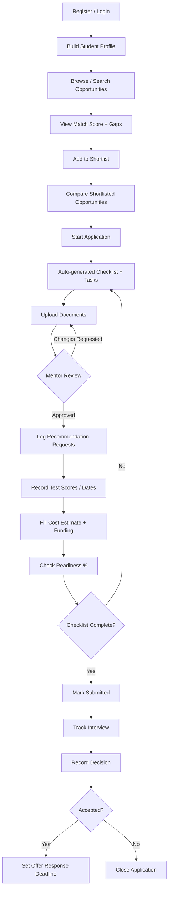
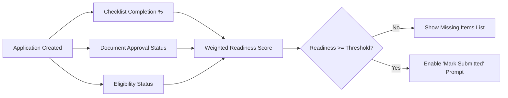
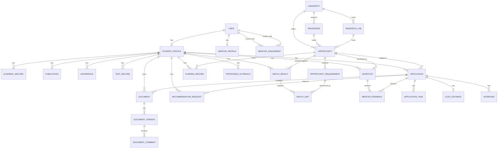

# PUB GradPath — Product Requirements Document (PRD)
### Higher-Study Discovery and Application Workspace
**Version:** 1.0 (MVP) | **Status:** Draft — Single Source of Truth | **Owner:** Solo Developer / Product Owner

---

## Section 1: Executive Summary

**Product Overview**
PUB GradPath is a web-based workspace that helps students discover suitable higher-study opportunities abroad (programmes, professors, labs, scholarships), evaluate their eligibility, prepare application materials, coordinate with mentors and professors, estimate costs, and track every application from shortlist to final decision — replacing scattered notes, spreadsheets, and browser tabs.

**Problem Being Solved**
Students lose track of requirements, miss deadlines, request recommendation letters too late, and underestimate costs because information is fragmented across many sources with no central system to connect a student's profile to opportunity requirements and application progress.

**Proposed Solution**
A single workspace with: (1) a structured student profile, (2) a searchable opportunity database with source/verification metadata, (3) deterministic profile-to-opportunity matching with transparent gap analysis, (4) shortlisting and comparison, (5) eligibility/test tracking, (6) application checklists with reminders, (7) a document manager with mentor review, (8) professor outreach and recommendation tracking, (9) funding and cost estimation, and (10) readiness scoring and outcome tracking.

**Target Audience**
- **Students/Applicants** applying for Master's, PhD, research positions, or scholarships abroad.
- **Mentors** (seniors, advisors, professors) who review documents and give feedback.
- **Administrators** who maintain the opportunity database and user accounts.

**Primary Value Proposition**
"See exactly what you need, what you're missing, and when it's due — in one place, instead of twenty tabs."

**MVP Scope**
All 10 required feature groups (FR-01 to FR-10), manual + CSV-imported opportunity data, deterministic (non-AI) matching and eligibility logic, in-app + email reminders, role-based access for Student/Mentor/Admin.

**Explicitly Out of MVP Scope**
Web scraping of external sites, AI-dependent core logic, native mobile apps, payment processing, real-time chat, automatic email sending to professors, live FX rate APIs.

**Long-Term Vision**
Optional AI-assisted match explanations and SOP feedback, interview practice module, calendar sync (Google Calendar), automatic deadline-change detection through legitimate APIs, and multi-mentor/institutional deployment.

---

## Section 2: Goals and Non-Goals

### Primary Goals
- G1: Centralize opportunity discovery with transparent, verifiable data (source + last-checked date).
- G2: Give students a clear, explainable fit score and requirement gap list per opportunity.
- G3: Prevent missed deadlines through checklists, tasks, and reminders.
- G4: Provide a single place for document versioning and mentor feedback.
- G5: Make estimated total cost and funding status visible before committing to an application.

### Secondary Goals
- S1: Enable mentors to efficiently review multiple students without needing separate tools.
- S2: Give administrators a maintainable way to keep opportunity data fresh and accurate.
- S3: Provide a readiness view that aggregates checklist, document, and eligibility status.

### MVP Objectives (Measurable)
- A student can go from profile creation → shortlist → application → task completion → document upload → outcome tracking without leaving the app.
- Matching and eligibility logic must be 100% deterministic and explainable (no black-box scoring) in v1.
- Every opportunity record must display `source` and `lastCheckedAt`.

### Explicitly Excluded From MVP
- Automatic web scraping (ToU violation — manual/import only).
- AI-based matching as a *required* dependency (optional, additive only, Section 12).
- Automatic outbound emails to professors (manual logging only, FR-08).
- Payment gateway integration.
- Native mobile apps (responsive web only).
- Multi-language i18n (English only in v1).
- Real-time collaborative editing of documents.

### Future Enhancements (Post-MVP)
AI match explanation text, AI-assisted SOP feedback, interview practice with AI scoring, Google Calendar sync, automated deadline-change detection via legitimate university/scholarship APIs, multi-mentor assignment pools, admin-side bulk data verification workflows.

---

## Section 3: User Personas and Role Permissions

### Persona 1 — Student / Applicant ("Rafi")
- **Goal:** Find 5–10 well-matched programmes, apply to the best 3–4, not miss any deadline.
- **Pain points:** Doesn't know which requirements he's missing; forgets to follow up with professors; underestimates cost.
- **Workflow:** Build profile → browse/search → check match & gaps → shortlist → compare → start application → complete checklist → upload documents → request recommendations → track outcome.

### Persona 2 — Mentor ("Dr. Nusrat" / senior student)
- **Goal:** Help 3–8 assigned students make good choices and submit strong documents without excessive back-and-forth.
- **Pain points:** No visibility into which students need review now; feedback gets lost in email threads.
- **Workflow:** Log in → see assigned students needing review → open document/shortlist → leave feedback → mark reviewed.

### Persona 3 — Administrator
- **Goal:** Keep the opportunity database accurate and useful; manage accounts.
- **Pain points:** Manual data entry is tedious; stale data erodes trust.
- **Workflow:** Add/edit opportunity records → import sample dataset → mark verification status → manage users → monitor data freshness.

### Role-Permission Matrix

| Resource | Student (own) | Student (others) | Mentor (assigned student) | Mentor (unassigned) | Admin |
|---|---|---|---|---|---|
| StudentProfile | View/Edit | No access | View only | No access | View only (support) |
| Opportunity records | View | View | View | View | Create/Edit/Delete |
| MatchResult | View | No access | View | No access | No access |
| Shortlist | Create/Edit/Delete | No access | View + Add feedback | No access | No access |
| Application | Create/Edit (own) | No access | View | No access | No access (view for support only) |
| ApplicationTask | Create/Edit/Delete | No access | View | No access | No access |
| Document | Create/Edit/Delete versions | No access | View + Comment | No access | No access |
| RecommendationRequest / Outreach | Create/Edit | No access | View | No access | No access |
| Funding/CostEstimate | Create/Edit | No access | View | No access | No access |
| User accounts | View/Edit own | No access | View own | No access | Create/Edit/Disable |
| AuditLog | No access | No access | No access | No access | View |

**Enforcement rule:** All authorization is enforced **server-side** (Server Actions / Route Handlers check `session.user.role` and resource ownership before any read/write). Frontend route guards are UX-only, never the security boundary. Mentor access to a student is valid only if an active `MentorAssignment` row exists.

---

## Section 4: Functional Requirements

> Format per requirement: ID · Description · Business Value · User Story · Acceptance Criteria · Input/Output · Validation · Permissions · Errors/Edge Cases · Dependencies · Priority

### FR-01: Student Profile Management
**Description:** Students maintain academic background, interests, skills, publications, experience, and documents.
**Business Value:** Profile is the foundation input for matching, eligibility, and readiness — without it, no other feature functions.
**User Story:** As a student, I want to build a structured profile so that the system can match me to opportunities and identify gaps.

**Acceptance Criteria**
- AC1: User can create/edit AcademicRecord (degree, institution, CGPA, field, start/end year); multiple records allowed.
- AC2: User can add/remove ResearchInterest and Skill tags (min 0, no hard max in MVP, soft cap 20 each for UI).
- AC3: User can add Publication entries (title required; venue, year, link optional).
- AC4: User can add Experience entries (role, organization, start/end date, description).
- AC5: Profile completeness % is computed and shown (weighted: academics 25%, interests/skills 15%, documents 25%, tests 20%, experience/publications 15%).
- AC6: Required field validation blocks save with inline error messages (e.g., CGPA must be 0–4 or 0–5 scale selectable).

**Input/Output:** Input: form fields per sub-entity. Output: persisted `StudentProfile` + child records; completeness score (0–100).
**Validation:** CGPA numeric within declared scale; years within 1950–current+1; URLs must be valid format if provided.
**Permissions:** Student (own profile) — Create/Edit/Delete. Mentor — Read-only (if assigned). Admin — Read-only.
**Error/Edge Cases:** Empty profile → completeness 0%, matching disabled with explanatory message "Complete your profile to see matches." Duplicate publication titles allowed (not deduplicated in MVP).
**Dependencies:** None (foundation feature).
**Priority:** **P0**

---

### FR-02: Opportunity Discovery and Database
**Description:** Searchable records of programmes, universities, professors, labs, and scholarships with source and verification metadata.
**Business Value:** Core discovery surface; data trustworthiness (source + last-checked) is the product's credibility anchor.
**User Story:** As a student, I want to search and filter opportunities by field, country, funding, and deadline so I can find relevant options quickly.

**Acceptance Criteria**
- AC1: Admin can create/edit/soft-delete University, Professor, Lab, Opportunity, Scholarship records via forms.
- AC2: Every Opportunity record stores `source` (URL or text) and `lastCheckedAt` (date), both mandatory at creation.
- AC3: Students can search by free text (title/field) and filter by country, degree level, funding type, field of study, deadline range.
- AC4: Search results paginated (20/page), sortable by deadline (ascending default).
- AC5: CSV/JSON import tool validates required columns and reports row-level errors without aborting the whole batch.
- AC6: Each Opportunity detail page displays a "Data verification status" badge: `Verified`, `Needs Recheck` (auto-flagged if `lastCheckedAt` > 90 days old), `Unverified`.

**Input/Output:** Input: admin form or CSV; Output: Opportunity + related Requirement rows; search input → paginated result list.
**Validation:** `deadline` must be a future date at creation (warn, not block, since historical/demo records may be past); `source` non-empty; numeric fields (fees, min scores) ≥ 0.
**Permissions:** Admin — full CRUD. Student/Mentor — read-only.
**Error/Edge Cases:** Import file with missing required column → reject entire import with clear error before processing; duplicate Opportunity (same title+university) → warn admin, allow override.
**Dependencies:** University/Professor/Lab must exist or be created inline during Opportunity creation.
**Priority:** **P0**

---

### FR-03: Profile-to-Opportunity Matching
**Description:** Deterministic rule-based comparison of student profile against opportunity requirements, producing a score and explicit gap list.
**Business Value:** Saves students from manually re-reading every requirement list; builds trust through transparency.
**User Story:** As a student, I want to see why an opportunity is or isn't a good fit so I know what to improve.

**Acceptance Criteria**
- AC1: For every (StudentProfile, Opportunity) pair viewed, system computes a score 0–100 using the deterministic algorithm (Section 12).
- AC2: Score breakdown is visible (e.g., "Research interest overlap: 40/50, Test requirement: not met, GPA: met").
- AC3: Every unmet or unknown requirement appears in a visible "Gaps" list with the specific missing item (e.g., "IELTS score not recorded", "Requires 1 publication, you have 0").
- AC4: UI displays disclaimer: *"This score reflects profile-requirement overlap only and is not an admission guarantee."*
- AC5: Missing data is never silently treated as "met" — it is always shown as "Unknown/Missing," distinct from "Not Met."
- AC6: MatchResult is cached (`MatchResult` table) and recalculated only when profile or requirement data changes (not on every page view).

**Input/Output:** Input: StudentProfile + Opportunity.Requirements; Output: score (float), gaps[] (with requirement reference + reason).
**Validation:** N/A (computed, not user-entered).
**Permissions:** Student — view own matches only. Mentor — view assigned student's matches.
**Error/Edge Cases:** Opportunity with zero defined requirements → score based on interest/field overlap only, gaps list empty, UI note: "This opportunity has no recorded requirements yet."
**Dependencies:** FR-01 (profile data), FR-02 (requirement data).
**Priority:** **P0**

---

### FR-04: Opportunity Comparison and Shortlisting
**Description:** Add opportunities to a shortlist and compare them side-by-side.
**Business Value:** Reduces decision fatigue when narrowing from many options to a final application list.
**User Story:** As a student, I want to compare my shortlisted opportunities side-by-side so I can decide where to apply.

**Acceptance Criteria**
- AC1: Student can add/remove an Opportunity to/from Shortlist from the opportunity detail or search results.
- AC2: Shortlist page shows a comparison table with columns: Match score, Funding, Estimated cost (if CostEstimate exists), Deadline, Eligibility status.
- AC3: Student can select 2–5 shortlisted items for a focused side-by-side comparison view.
- AC4: Student can add free-text notes per shortlisted item.
- AC5: Mentor can add feedback comments on a shortlisted item, timestamped and attributed; visible to the student.
- AC6: Duplicate shortlist entries for the same (student, opportunity) are prevented (unique constraint).

**Input/Output:** Input: opportunityId to add/remove, note text; Output: Shortlist list, comparison table data.
**Validation:** Note max 2000 characters.
**Permissions:** Student — manage own shortlist/notes. Mentor (assigned) — add feedback, cannot edit student notes.
**Error/Edge Cases:** Shortlisting an opportunity with a past deadline → allowed but flagged with a warning badge "Deadline passed."
**Dependencies:** FR-02, FR-03 (for score display).
**Priority:** **P0**

---

### FR-05: Eligibility and Test Tracking
**Description:** Track test records (IELTS, GRE, etc.) and evaluate eligibility against opportunity requirements.
**Business Value:** Prevents students from applying to programmes they structurally cannot meet, or missing a required test registration deadline.
**User Story:** As a student, I want to know if I meet an opportunity's test/score requirements, and if not, whether a planned test date will cover it.

**Acceptance Criteria**
- AC1: Student can add TestRecord entries: testType, achieved score (JSON structure for multi-section tests), plannedDate, actualDate.
- AC2: For each Opportunity requirement of type `TEST_SCORE`, system compares achieved score (if present) to `minValue`.
- AC3: Eligibility state per requirement is one of exactly four values: `ELIGIBLE`, `NOT_ELIGIBLE`, `POTENTIALLY_ELIGIBLE` (planned test date exists, no score yet), `INSUFFICIENT_INFORMATION` (no record at all).
- AC4: Overall opportunity eligibility status is the worst-case among all requirement states (e.g., one `NOT_ELIGIBLE` → overall `NOT_ELIGIBLE`).
- AC5: Score comparisons must respect scale (e.g., IELTS 0–9 vs GRE 260–340) — stored per TestType with a defined comparison direction (higher-is-better for all current test types in MVP).

**Input/Output:** Input: TestRecord fields; Output: per-requirement and overall eligibility state.
**Validation:** Score values must fall within the valid range for the TestType (e.g., IELTS 0–9, step 0.5).
**Permissions:** Student — manage own test records. Mentor — view only.
**Error/Edge Cases:** Opportunity requirement references a TestType the student has never recorded → `INSUFFICIENT_INFORMATION`, never defaults to eligible.
**Dependencies:** FR-01, FR-02.
**Priority:** **P0**

---

### FR-06: Application Tasks, Checklists, and Reminders
**Description:** Application-specific task lists with deadlines, dependencies, and reminders.
**Business Value:** Directly addresses the core pain point — missed deadlines and forgotten steps.
**User Story:** As a student, I want an auto-generated checklist per application with reminders so nothing is missed.

**Acceptance Criteria**
- AC1: Starting an Application auto-generates a default task set (Submit SOP, Submit CV, Request 2 recommendations, Submit test scores, Pay application fee, Submit application) — editable afterward.
- AC2: Student can add custom tasks with title, description, deadline, priority (Low/Medium/High).
- AC3: Task can declare a `dependsOnId` (another task in the same application); a dependent task is shown as `BLOCKED` until its dependency is `DONE`.
- AC4: Task statuses: `PENDING`, `IN_PROGRESS`, `DONE`, `BLOCKED`, and computed `OVERDUE` (deadline passed, not DONE) shown as a visual flag, not a stored enum value.
- AC5: A reminder is generated at T-7, T-3, T-1 days before a task deadline (configurable per user in Settings), delivered in-app always, by email if enabled.
- AC6: Reminders are not sent twice for the same task+threshold (idempotency guaranteed by `reminderSentAt`/log check, Section 15).

**Input/Output:** Input: task fields; Output: task list, computed overdue flags, scheduled Reminder rows.
**Validation:** `dependsOnId` cannot reference a task from a different application or itself; circular dependency rejected at save time.
**Permissions:** Student — full CRUD on own application tasks. Mentor — view only.
**Error/Edge Cases:** Deleting a task that others depend on → block deletion, show which tasks depend on it, offer to remove dependency links first.
**Dependencies:** FR-02 (requirements inform auto-generated checklist), background job infrastructure.
**Priority:** **P0** (core tasks/checklist), **P1** (configurable reminder preferences)

---

### FR-07: Document Management
**Description:** SOP, CV, research statement management with versioning and mentor review.
**Business Value:** Centralizes the most time-sensitive, iteration-heavy artifact in the application process.
**User Story:** As a student, I want to upload document versions and get mentor feedback so I can improve before submitting.

**Acceptance Criteria**
- AC1: Student can upload a Document of type SOP/CV/RESEARCH_STATEMENT/OTHER, either as a general (profile-level) document or tied to a specific Application.
- AC2: Each upload creates a new immutable `DocumentVersion` (incrementing `versionNo`); prior versions remain viewable, never overwritten.
- AC3: Each version has a `reviewStatus`: `DRAFT` → `IN_REVIEW` → `APPROVED` or `CHANGES_REQUESTED`. Only Mentor/Student (not Admin) can change review status; Admin has no access to document content.
- AC4: Mentor can add comments on a specific version; comments are timestamped and attributed.
- AC5: Allowed file types: PDF, DOCX only; max size 10MB; rejected files show a specific error (type or size).
- AC6: File download/view URLs are time-limited signed URLs (never permanently public); access check confirms requester is the owner or an assigned mentor before generating the signed URL.

**Input/Output:** Input: file + metadata; Output: DocumentVersion record + storage reference (URL + storage key).
**Validation:** MIME type whitelist, size limit, filename sanitization.
**Permissions:** Student (owner) — upload/view own; Mentor (assigned) — view/comment on assigned student's documents; no cross-student access.
**Error/Edge Cases:** Upload failure mid-transfer → no partial DocumentVersion row created (transactional); corrupted/mismatched MIME (e.g., renamed .exe to .pdf) → rejected via content-type sniffing, not just extension check.
**Dependencies:** File storage service (Section 10), FR-01/FR-06 for association.
**Priority:** **P0**

---

### FR-08: Professor Outreach and Recommendation Tracking
**Description:** Manual logging of professor contact, outreach emails, and recommendation letter requests.
**Business Value:** Prevents dropped follow-ups, a commonly cited failure mode in the problem statement.
**User Story:** As a student, I want to log my outreach emails and recommendation requests with follow-up reminders so nothing falls through the cracks.

**Acceptance Criteria**
- AC1: Student can create an OutreachLog entry (professor name/email, opportunity link optional, sent date, notes) — logged manually, no email sending.
- AC2: Student can mark `replyReceived` = true/false and set `followUpAt` date.
- AC3: Student can create a RecommendationRequest (professor name/email, linked application optional, status: `NOT_REQUESTED/REQUESTED/SUBMITTED/DECLINED`, `requestedAt`, `followUpAt`).
- AC4: System generates an in-app reminder if `followUpAt` passes with `replyReceived = false` (outreach) or status still `REQUESTED` (recommendation).
- AC5: Before creating a new follow-up reminder for the same contact+opportunity pair within 48 hours, system warns "A follow-up reminder for this contact already exists" (soft duplicate prevention, not a hard block).

**Input/Output:** Input: contact/log fields; Output: OutreachLog / RecommendationRequest rows, reminders.
**Validation:** Email format validated if provided (not required — some outreach may be via other channels).
**Permissions:** Student — full CRUD own records. Mentor — view only.
**Error/Edge Cases:** No linked application (general outreach before shortlisting) → allowed, `applicationId` nullable.
**Dependencies:** FR-02 (professor records, optional link), FR-06 reminder infrastructure.
**Priority:** **P1**

---

### FR-09: Scholarship, Funding, and Cost Estimation
**Description:** Track funding sources and compute estimated total/net cost per application.
**Business Value:** Addresses underestimated costs, a stated core problem.
**User Story:** As a student, I want to estimate my total cost and see funding offset so I understand the real financial picture.

**Acceptance Criteria**
- AC1: Student can record Funding entries (name, amount, currency, status: AVAILABLE/APPLIED/AWARDED/REJECTED), linked to an Opportunity and/or personal (external scholarship).
- AC2: Student can create a CostEstimate per Application: fees, living cost, travel cost — each with its own amount + currency + free-text assumption note.
- AC3: System computes `totalEstimatedCost` by converting all entries to a student-selected base currency using a **user-entered exchange rate** (not live-fetched) with a mandatory "rate as of [date]" field.
- AC4: `netCost = totalEstimatedCost − sum(AWARDED funding in base currency)`.
- AC5: UI clearly labels all amounts as "Estimated — user-provided figures, not verified," and distinguishes `AWARDED` (counted) from `APPLIED`/`AVAILABLE` (not counted in net cost, shown separately as "potential funding").
- AC6: Missing cost fields default to 0 with a visible "Not estimated yet" badge rather than being silently excluded without indication.

**Input/Output:** Input: cost/funding fields + exchange rate; Output: totalEstimatedCost, netCost, breakdown table.
**Validation:** All amounts ≥ 0; currency must be a valid ISO 4217 code from a fixed list; exchange rate > 0.
**Permissions:** Student — full CRUD own. Mentor — view only.
**Error/Edge Cases:** Multiple currencies with no conversion rate entered for one → total marked "Incomplete — missing conversion rate for [currency]" instead of silently omitting it.
**Dependencies:** FR-02 (scholarship association), FR-10 (feeds readiness/cost summary).
**Priority:** **P1**

---

### FR-10: Application Readiness and Outcome Tracking
**Description:** Aggregate readiness view and outcome tracking through submission, interview, decision.
**Business Value:** Single-glance answer to "Am I ready to submit, and what's my status everywhere?"
**User Story:** As a student, I want a readiness score and outcome tracker so I know what's left to do and what has happened so far.

**Acceptance Criteria**
- AC1: Application has a `status` enum: `DRAFT → IN_PROGRESS → SUBMITTED → INTERVIEW → DECISION → CLOSED`, transitions are student-triggered (manual), not auto-inferred, except `SUBMITTED` auto-suggested when all P0 checklist tasks are DONE (confirmation prompt, not automatic).
- AC2: Readiness % = weighted average of: checklist completion (40%), required documents at `APPROVED` status (30%), eligibility (`ELIGIBLE` on all requirements = 100%, else 0%) (30%).
- AC3: Dashboard lists, per application: missing documents, incomplete tasks, unmet requirements — each as an actionable link.
- AC4: Decision field: `PENDING/ACCEPTED/REJECTED/WAITLISTED`; recording a decision requires a decision date and optional notes.
- AC5: If decision = `ACCEPTED`, student can set `offerResponseDeadline`; a reminder is scheduled automatically at T-7/T-3/T-1.
- AC6: Interview fields (date, mode, notes) are optional sub-record of Application; multiple interview rounds supported via a list.

**Input/Output:** Input: status transitions, interview/decision data; Output: readiness %, status summary.
**Validation:** `offerResponseDeadline` required if decision = ACCEPTED; decision date cannot be before `submittedAt`.
**Permissions:** Student — full control of own application lifecycle. Mentor — view only, can comment via MentorFeedback.
**Error/Edge Cases:** Application marked SUBMITTED with incomplete P0 tasks → allowed (student's choice) but shows a persistent warning badge "Submitted with incomplete checklist."
**Dependencies:** FR-06, FR-07, FR-05 (feeds readiness calculation).
**Priority:** **P0**

---

## Section 5: User Journeys and Workflows

### Journey A — Student Registration to First Shortlist
1. Register (email/password or Google) → verify email (optional gate, see Section 13) → select role `STUDENT`.
2. Complete profile: academics → interests/skills → publications/experience → documents (optional at this stage).
3. Browse/search opportunities → filter by field/country/deadline.
4. Open an opportunity → view match score + gap list.
5. Add to shortlist → add personal notes.
6. Compare 2+ shortlisted opportunities side-by-side.

### Journey B — Preparing and Submitting an Application
1. From shortlist, click "Start Application" on a chosen opportunity.
2. System auto-generates default checklist tasks.
3. Student uploads SOP/CV versions → requests mentor review.
4. Mentor reviews, comments, sets status `CHANGES_REQUESTED` or `APPROVED`.
5. Student logs recommendation requests and professor outreach.
6. Student records test scores / planned test dates.
7. Student fills CostEstimate and links Funding.
8. Readiness dashboard shows % complete and remaining gaps.
9. Student marks checklist tasks DONE; system prompts "Mark as Submitted?" when all P0 tasks complete.
10. Student records submission date → status `SUBMITTED`.
11. Student records interview (if any) → records decision → (if accepted) sets offer-response deadline.

### Mermaid — Primary Student Application Journey



### Mermaid — Application Readiness Workflow



### Other Workflows (Summarized)
- **Mentor Review:** Login → Dashboard (pending reviews count) → Open assigned student → Review document/shortlist → Leave comment/status → Done.
- **Admin Opportunity Management:** Login → Admin dashboard → Opportunity list (verification status) → Edit/Add record → Update `lastCheckedAt` → Save.
- **Interview/Decision Recording:** Application workspace → Outcomes tab → Add interview round → Record decision → (if accepted) set offer deadline → reminder auto-scheduled.

---

## Section 6: Information Architecture and Sitemap

### Student Routes
```
/dashboard
/profile
/opportunities                     (Discover + search/filter)
/opportunities/[id]                (Detail + match + gaps + shortlist action)
/shortlist                         (List + comparison table; compare view as a modal/tab, not separate route)
/applications                      (List of all applications)
/applications/[id]                 (Workspace — tabs: Overview, Tasks, Documents, Outreach, Funding, Outcome)
/calendar                          (Unified task + test + deadline calendar view)
/tests                             (Test record tracker — could be a tab inside /profile, kept separate for clarity)
/notifications
/settings
```
*Design decision:* Documents, Outreach, Funding, and Tasks are **tabs inside `/applications/[id]`**, not standalone top-level routes — they are application-scoped, not independent resources a student browses globally. A read-only global `/documents` view (all versions across applications) is a **P1** addition, not required for MVP.

### Mentor Routes
```
/mentor/dashboard
/mentor/students                   (Assigned students list)
/mentor/students/[id]               (Profile + shortlist + applications read view, tabs)
/mentor/reviews                     (Pending document reviews queue, cross-student)
```
*Design decision:* "Application Feedback" and "Review History" are tabs within `/mentor/students/[id]`, not separate top-level pages.

### Administrator Routes
```
/admin/dashboard
/admin/opportunities                (List + CRUD, includes Universities/Programs/Professors/Labs as tabs/sub-sections)
/admin/opportunities/[id]/edit
/admin/scholarships
/admin/users
/admin/data-verification            (Stale-data report: lastCheckedAt > 90 days)
```
*Design decision:* Universities, Professors, and Labs are managed as **related entities within the Opportunity management screen** (linked dropdown/inline-create), not four separate top-level sections — reduces navigation overhead for a solo-maintained admin area.

---

## Section 7: Dashboard Requirements

### Student Dashboard
**Purpose:** Answer "What do I need to do today, and where do I stand?"

| Widget | Data | Empty State | Loading | Error |
|---|---|---|---|---|
| Active Applications | Count + status chips | "No applications yet — start from your shortlist" | Skeleton cards | "Couldn't load applications, retry" |
| Upcoming Deadlines (7 days) | Task/test/application deadlines, sorted | "No upcoming deadlines" | Skeleton list | Retry banner |
| Overdue Tasks | Count + list, red badge | Hidden if none | Skeleton | Retry banner |
| Readiness Summary | Per-application readiness % bar | N/A if no applications | Skeleton bars | Retry banner |
| Shortlisted Opportunities | Count + top 3 by deadline | "Browse opportunities to shortlist" CTA | Skeleton | Retry banner |
| Missing Requirements | Aggregated gap count across active applications | Hidden if none | Skeleton | Retry banner |
| Document Review Status | Pending/Approved/Changes-Requested counts | "Upload your first document" CTA | Skeleton | Retry banner |
| Funding Summary | Total estimated cost vs. awarded funding | "Add a cost estimate" CTA | Skeleton | Retry banner |

### Mentor Dashboard
- Assigned students count, pending document reviews (queue with oldest first), upcoming student deadlines (aggregated), recently submitted applications needing feedback.
- Empty state: "No students assigned yet" (admin-managed).

### Administrator Dashboard
- Total opportunities (by verification status: Verified/Needs Recheck/Unverified), records needing recheck (>90 days), recently added records, total users by role, recent account issues (if any flagged).

---

## Section 8: UI/UX Requirements

- **Design direction:** Clean academic SaaS aesthetic — neutral palette, generous white space, single accent color for primary actions, no decorative illustrations competing with data density.
- **Navigation:** Persistent left sidebar (desktop) with role-based items; collapses to bottom tab bar or hamburger drawer on mobile.
- **Responsive breakpoints:** Mobile (<640px) — single column, stacked cards; Tablet (640–1024px) — 2-column where applicable; Desktop (>1024px) — full table/comparison views.
- **Reusable components:** StatusBadge (color-coded by enum), DeadlineChip (color shifts: green >7d, amber ≤7d, red overdue), DataTable (sort/filter/paginate), EmptyState, ConfirmDialog (destructive actions), FileUploadZone, ScoreBar (0–100 with breakdown tooltip), Skeleton loaders per component type.
- **Forms:** Inline validation on blur, submit-disabled until valid, field-level error messages (not just a toast), autosave draft for long text fields (SOP notes) — client-side only in MVP (no backend draft table required).
- **Tables:** Server-side pagination for Opportunity search (dataset could grow large); client-side pagination acceptable for per-student lists (tasks, documents — bounded size).
- **Search:** Debounced input (300ms), filter chips shown as removable pills, "Clear all filters" action.
- **Confirmation dialogs:** Required for: delete profile data, delete document version, delete shortlist item, close/withdraw application.
- **Feedback states:** Toasts for success/error on mutations; inline skeletons for loading; explicit empty-state illustrations/text per widget (see Section 7 table).
- **Accessibility:** All interactive elements keyboard-navigable (Tab/Enter/Esc), semantic HTML (`<nav>`, `<main>`, `<table>`), ARIA labels on icon-only buttons, color is never the sole status indicator (icon + text accompany badges), minimum WCAG AA contrast.
- **Formatting standards:** Dates displayed as `DD MMM YYYY` (e.g., 12 Mar 2026), stored in UTC, rendered in the user's browser timezone; currency displayed with ISO code + amount (e.g., `USD 25,000`), never a bare symbol alone to avoid ambiguity.

---

## Section 9: Data Model and Database Design

**Approach:** PostgreSQL + Prisma. Entities normalized; array/JSON fields used only for genuinely unstructured or variable-shape data (e.g., multi-section test scores). Soft delete (`isDeleted`, `deletedAt`) applied to records with cross-references that must survive deletion for audit/history (User, Opportunity-related entities, Documents). Hard delete acceptable for purely owned child data with no external references (e.g., a Reminder).

### Mermaid ER Diagram (Core Entities)



### Prisma Model Structure (Representative — full schema inherits conventions established in prior review: `@map`, named unique constraints, `onDelete`/`onUpdate` cascade rules, soft delete fields)

```prisma
model StudentProfile {
  id        String   @id @default(uuid())
  userId    String   @unique
  interests String[]
  skills    String[]
  isDeleted Boolean  @default(false)
  deletedAt DateTime?
  createdAt DateTime @default(now())
  updatedAt DateTime @updatedAt

  user User @relation(fields: [userId], references: [id], onDelete: Cascade, onUpdate: Cascade)

  academics            AcademicRecord[]
  publications         Publication[]
  experiences          Experience[]
  documents            Document[]
  testRecords          TestRecord[]
  shortlists           Shortlist[]
  applications         Application[]
  matchResults         MatchResult[]
  fundingRecords        FundingRecord[]
  outreachLogs         ProfessorOutreach[]
  recommendationRequests RecommendationRequest[]

  @@map("student_profiles")
}

model Opportunity {
  id            String          @id @default(uuid())
  type          OpportunityType
  title         String
  universityId  String
  professorId   String?
  labId         String?
  fieldOfStudy  String
  deadline      DateTime?
  source        String
  lastCheckedAt DateTime
  verificationStatus VerificationStatus @default(UNVERIFIED)
  createdById   String
  isDeleted     Boolean   @default(false)
  deletedAt     DateTime?
  createdAt     DateTime  @default(now())
  updatedAt     DateTime  @updatedAt

  university   University  @relation(fields: [universityId], references: [id], onDelete: Cascade, onUpdate: Cascade)
  professor    Professor?  @relation(fields: [professorId], references: [id], onDelete: SetNull, onUpdate: Cascade)
  lab          ResearchLab? @relation(fields: [labId], references: [id], onDelete: SetNull, onUpdate: Cascade)

  requirements OpportunityRequirement[]
  matchResults MatchResult[]
  shortlists   Shortlist[]
  applications Application[]
  fundingRecords FundingRecord[]

  @@index([fieldOfStudy])
  @@index([deadline])
  @@map("opportunities")
}

model MatchResult {
  id               String   @id @default(uuid())
  studentProfileId String
  opportunityId    String
  score            Float
  computedAt       DateTime @default(now())

  studentProfile StudentProfile @relation(fields: [studentProfileId], references: [id], onDelete: Cascade, onUpdate: Cascade)
  opportunity    Opportunity    @relation(fields: [opportunityId], references: [id], onDelete: Cascade, onUpdate: Cascade)
  gaps           MatchGap[]

  @@unique([studentProfileId, opportunityId], name: "unique_match_result")
  @@map("match_results")
}

enum OpportunityType { PROGRAMME PROFESSOR_OPENING LAB_POSITION SCHOLARSHIP }
enum VerificationStatus { VERIFIED NEEDS_RECHECK UNVERIFIED }
```

*(Full entity list — AcademicRecord, Experience, Publication, Skill-as-array, ResearchInterest-as-array, University, Program, Professor, ResearchLab, Scholarship-as-FundingRecord-subset, OpportunityRequirement, Shortlist, MentorAssignment, Application, ApplicationTask, TaskDependency-as-self-relation, Document, DocumentVersion, DocumentComment, TestRecord, ProfessorOutreach, RecommendationRequest, FundingRecord, CostEstimate, Interview, ApplicationDecision-as-fields-on-Application, Notification-as-Reminder, AuditLog — follow the same conventions as the detailed schema already reviewed and approved in the prior design pass.)*

**Design simplifications made (per instruction not to over-table):**
- `Skill` and `ResearchInterest` kept as `String[]` on StudentProfile rather than separate tables — no additional attributes needed per skill/interest in MVP.
- `ApplicationDecision` merged as fields on `Application` (`decision`, `decisionDate`, `decisionNotes`) rather than a separate table — 1:1 relationship with no independent lifecycle.
- `TaskDependency` implemented as a self-relation field on `ApplicationTask` (`dependsOnId`) rather than a join table — one dependency per task is sufficient for MVP.
- `Notification` implemented as `Reminder` (already defined) — same concept, one table.
- `Scholarship` implemented as `FundingRecord` with `opportunityId` nullable — avoids a duplicate near-identical table.

**Ownership & Access Control Rule:** Every query touching student-owned data (`StudentProfile`, `Application`, `Document`, etc.) must filter by `studentProfileId = session.user.studentProfile.id` OR verify an active `MentorAssignment` for mentor reads. This check lives in a shared `assertOwnership()`/`assertMentorAccess()` helper used by every Server Action — never trusted from client input.

**Shared vs. Private Data:** `University`, `Professor`, `ResearchLab`, `Opportunity`, `OpportunityRequirement` are globally shared/read-only to students. `Shortlist`, `Application`, `Document`, `TestRecord`, `FundingRecord`, `CostEstimate` are strictly private per student.

**Schema Evolution Strategy:** Prisma Migrate with timestamped migration files committed to version control; additive changes (new nullable columns, new enums values via expand-then-contract) preferred over destructive changes; a staging database mirrors production for migration dry-runs before deploy.

---

## Section 10: Technical Architecture

### Architecture Decision: Next.js Full-Stack (Monolith) — Chosen for MVP

| Criterion | Next.js Full-Stack | Separate Express API |
|---|---|---|
| Solo-dev overhead | Low — one codebase, one deploy | Higher — two codebases, CORS, duplicate auth/validation |
| Type safety front-to-back | High (shared TS types, Server Actions) | Requires manual contract sync or codegen |
| Deployment | Single Vercel/Node deployment | Two services to deploy/monitor |
| File upload handling | Route Handlers support streaming uploads fine | Same capability, no advantage |
| Background jobs (reminders) | Needs external cron (Vercel Cron / separate worker) either way | Same requirement either way |
| Existing scaffold | N/A — fresh recommendation | Developer already has an Express+Prisma scaffold |

**Decision:** For a **solo developer building GradPath as a new product**, a **Next.js App Router monolith** (Server Actions for mutations, Route Handlers only for file upload/webhook endpoints) is recommended — it minimizes moving parts, deployment targets, and duplicate validation logic. If the developer prefers to reuse the existing Express+Prisma backend (already scaffolded, per earlier project), that is an **acceptable alternative** with equivalent functional outcome, at the cost of maintaining two deployable services and duplicating Zod schemas between client/server. This PRD documents the Next.js monolith as the primary reference architecture; the Express alternative is schema-compatible and can follow the same API contracts in Section 11 as REST routes instead of Server Actions.

### Layers & Responsibilities
- **Presentation:** React Server Components for data display; Client Components only where interactivity is required (forms, filters).
- **Mutation layer:** Server Actions for all create/update/delete operations (profile, tasks, documents metadata, etc.).
- **Route Handlers:** Used only for (a) file upload streaming to storage, (b) signed URL generation for downloads, (c) cron-triggered reminder job endpoint, (d) auth callback routes.
- **Data access:** Prisma Client, single shared instance, all queries wrapped in ownership-check helpers.
- **Validation:** Zod schemas shared between form (client) and Server Action (server) — defined once per entity in a `/lib/validation` directory.

### Authentication & Authorization
- Auth via a managed solution (e.g., Auth.js/NextAuth or Lucia) supporting credentials + Google OAuth, session stored in HTTP-only cookies.
- Role (`STUDENT/MENTOR/ADMIN`) embedded in session; every Server Action re-verifies role + ownership server-side regardless of what the UI allows.

### File Upload Architecture
- Client requests a signed upload URL (Route Handler) → uploads directly to private object storage (e.g., Cloudinary private mode or S3-compatible bucket with private ACL) → server records resulting URL/public ID in `DocumentVersion` only after upload confirmation.
- Downloads always go through a signed, time-limited URL generated server-side after an ownership check — never a permanently public link.

### Background Jobs & Reminders
- Single daily (and optionally hourly) cron job (Vercel Cron or `node-cron` if self-hosted) hits a protected Route Handler `/api/jobs/reminders` which scans for due reminders and sends them (in-app row insert + optional email).
- Idempotency via checking `Reminder.sentAt IS NULL` before processing, set immediately after send within the same transaction.

### Error Handling & Logging
- Centralized error boundary per route segment; Server Actions return typed `{ success, data?, error? }` results rather than throwing to the client.
- Structured server-side logging (request id, user id, action, outcome) to a log provider; no sensitive data (file contents, passwords, tokens) logged.

### Environments
- **Development:** local Postgres (Docker) + `.env.local`.
- **Staging:** separate database + separate storage bucket/folder, mirrors production config for migration testing.
- **Production:** managed Postgres, environment variables via hosting provider's secret manager, HTTPS enforced.

---

## Section 11: API / Server Action Contracts (Representative Set)

| Operation | Type | Role | Request | Response | Key Auth Rule |
|---|---|---|---|---|---|
| `updateStudentProfile` | Server Action | STUDENT | profile fields (Zod-validated) | `{success, profile}` | userId === session.user.id |
| `searchOpportunities` | Server Action/RSC fetch | any authenticated | filters, page | `{results[], total}` | Public to authenticated users |
| `getMatchResult(opportunityId)` | Server Action | STUDENT, MENTOR(assigned) | opportunityId | `{score, breakdown, gaps[]}` | Ownership or MentorAssignment check |
| `addToShortlist` | Server Action | STUDENT | opportunityId, notes? | `{success, shortlistId}` | Unique(studentId, opportunityId) enforced |
| `startApplication` | Server Action | STUDENT | opportunityId | `{applicationId}` | Must exist in Shortlist first |
| `createTask` / `updateTaskStatus` | Server Action | STUDENT | applicationId, task fields | `{task}` | Application ownership check; dependency cycle check |
| `uploadDocumentVersion` | Route Handler (`POST /api/documents/upload`) | STUDENT | multipart file + documentId/type | `{documentVersionId, fileUrl}` | MIME/size validation; ownership check |
| `getSignedDownloadUrl(versionId)` | Route Handler | STUDENT, MENTOR(assigned) | versionId | `{signedUrl, expiresAt}` | Ownership/assignment check before URL generation |
| `addDocumentComment` | Server Action | MENTOR(assigned) | documentVersionId, comment | `{comment}` | MentorAssignment must be active |
| `recordTestScore` | Server Action | STUDENT | testType, score json, dates | `{testRecord}` | Score range validated per testType |
| `createFundingRecord` / `createCostEstimate` | Server Action | STUDENT | amounts, currencies, rate+date | `{record}` | Amounts ≥ 0, currency whitelist |
| `updateApplicationStatus` | Server Action | STUDENT | applicationId, newStatus | `{application}` | Valid transition per state machine (Section 12) |
| `recordDecision` | Server Action | STUDENT | applicationId, decision, date, offerDeadline? | `{application}` | offerDeadline required if ACCEPTED |
| `createOpportunity` / `importOpportunities` | Server Action | ADMIN | opportunity fields / CSV | `{success, opportunityId / importReport}` | Role check ADMIN only |
| `assignMentor` | Server Action | ADMIN | mentorId, studentId | `{assignment}` | Role check ADMIN only |

Every Server Action follows this envelope:
```ts
type ActionResult<T> =
  | { success: true; data: T }
  | { success: false; error: { code: string; message: string } };
```
Error codes are enumerated (e.g., `UNAUTHORIZED`, `NOT_FOUND`, `VALIDATION_ERROR`, `CONFLICT`, `DEPENDENCY_CYCLE`) so the frontend can render specific messages, not generic failures.

---

## Section 12: Matching, Eligibility, Readiness, and Cost Algorithms

### 1. Profile-to-Opportunity Matching (Deterministic)

```
function computeMatchScore(student, opportunity):
    interestScore = overlap(student.interests, opportunity.fieldOfStudy + relatedTags) 
                     weighted at 40 points max
    skillScore    = overlap(student.skills, opportunity.requiredSkills)
                     weighted at 20 points max
    requirementScore = 0
    gaps = []
    totalReqWeight = 40  // remaining points distributed across requirements

    for req in opportunity.requirements:
        weight = totalReqWeight / count(opportunity.requirements)
        status = evaluateRequirement(student, req)   // see Eligibility algorithm
        if status == MET:
            requirementScore += weight
        else:
            gaps.append({ requirement: req, status: status, reason: explain(req, status) })

    score = interestScore + skillScore + requirementScore
    return { score: round(score), breakdown: {...}, gaps: gaps }
```
- Missing data → requirement treated as `INSUFFICIENT_INFORMATION`, contributes 0 points AND appears in `gaps` (never silently full-credited).
- Recalculation trigger: profile update OR opportunity/requirement update → invalidate cached `MatchResult` (set `computedAt` stale flag or delete+recompute on next view).

### 2. Eligibility Evaluation

```
function evaluateRequirement(student, requirement):
    if requirement.type == TEST_SCORE:
        record = findTestRecord(student, requirement.testType)
        if record == null: return INSUFFICIENT_INFORMATION
        if record.actualScore exists:
            return record.actualScore >= requirement.minValue ? ELIGIBLE : NOT_ELIGIBLE
        if record.plannedDate exists and record.plannedDate <= opportunity.deadline:
            return POTENTIALLY_ELIGIBLE
        return INSUFFICIENT_INFORMATION

    if requirement.type == GPA:
        academic = latestAcademicRecord(student)
        if academic.gpa == null: return INSUFFICIENT_INFORMATION
        return academic.gpa >= requirement.minValue ? ELIGIBLE : NOT_ELIGIBLE

    if requirement.type == PUBLICATION:
        count = student.publications.length
        return count >= requirement.minValue ? ELIGIBLE : NOT_ELIGIBLE

    if requirement.type == DEGREE:
        return studentHasDegree(student, requirement.detail) ? ELIGIBLE : NOT_ELIGIBLE

    return INSUFFICIENT_INFORMATION  // OTHER / unrecognized type, conservative default
```
**Overall Opportunity Eligibility** = worst state among all requirement evaluations, in priority order: `NOT_ELIGIBLE` > `INSUFFICIENT_INFORMATION` > `POTENTIALLY_ELIGIBLE` > `ELIGIBLE`.

### 3. Application Readiness Calculation

```
function computeReadiness(application):
    checklistScore = (tasksDone / totalTasks) * 40          // 0 if totalTasks == 0
    requiredDocs = applicableDocumentTypes(application)       // e.g., [SOP, CV]
    approvedDocs = count(docs where type in requiredDocs and latestVersion.reviewStatus == APPROVED)
    documentScore = (approvedDocs / requiredDocs.length) * 30

    eligibilityStatus = overallEligibility(application.opportunity, application.student)
    eligibilityScore = eligibilityStatus == ELIGIBLE ? 30 : 0

    readiness = checklistScore + documentScore + eligibilityScore
    return { readiness: round(readiness), 
              missingDocs: requiredDocs - approvedDocs, 
              incompleteTasks: tasksNotDone, 
              unmetRequirements: gaps }
```

### 4. Estimated Total and Net Cost Calculation

```
function computeCost(costEstimate, fundingRecords, baseCurrency):
    total = 0
    incomplete = false
    for item in [fees, livingCost, travel]:
        if item.currency == baseCurrency:
            total += item.amount
        elif item.exchangeRate exists:
            total += item.amount * item.exchangeRate
        else:
            incomplete = true   // flagged, not silently dropped

    awardedFunding = sum(f.amount_in_base for f in fundingRecords if f.status == AWARDED)
    netCost = total - awardedFunding
    potentialFunding = sum(f.amount_in_base for f in fundingRecords if f.status in [APPLIED, AVAILABLE])

    return { totalEstimatedCost: total, netCost: netCost, 
              potentialFunding: potentialFunding, incomplete: incomplete }
```

### 5. Upcoming / Overdue Deadline Detection

```
function classifyDeadline(deadline, now):
    if deadline == null: return NONE
    daysRemaining = (deadline - now) in days
    if daysRemaining < 0 and status != DONE: return OVERDUE
    if daysRemaining <= 7: return UPCOMING_URGENT
    if daysRemaining <= 30: return UPCOMING
    return SCHEDULED
```
All date math performed in UTC; display conversion happens client-side using the browser's timezone, never stored per-user.

**AI Extension Point (Optional, Non-Core):** The above deterministic score/gap output can optionally be passed to an LLM (e.g., Gemini free tier) purely to *generate human-readable explanation text* ("Explain why this is/isn't a good fit in 3 sentences"). This is strictly additive — if the AI call fails or is disabled, the deterministic score/gap list still fully functions. No AI call is in the critical path of matching, eligibility, readiness, or cost calculation.

---

## Section 13: Security, Privacy, and Reliability

- **Authentication:** Session-based via HTTP-only, Secure, SameSite=Lax cookies; passwords hashed with bcrypt (cost ≥ 10); Google OAuth as alternative provider.
- **Server-side authorization:** Every Server Action/Route Handler re-checks role + resource ownership from the session — never trusts a client-supplied `userId`/`role` field.
- **Student data isolation:** All student-scoped queries filtered by `studentProfileId` derived from session; mentor access gated by an active `MentorAssignment` row, re-checked on every request (not cached in session beyond the request).
- **Document security:** Private storage bucket/folder; access only via short-lived signed URLs generated after an authorization check; no document URL is ever rendered as a permanently public link.
- **File validation:** Whitelist MIME types (PDF/DOCX) verified by content-sniffing (not filename extension alone); max 10MB; files scanned for valid structure before acceptance where feasible.
- **Input validation / output encoding:** Zod schemas on every mutation input; React's default JSX escaping prevents XSS; any rendered rich text (mentor comments) is treated as plain text, not HTML.
- **Rate limiting:** Applied to auth endpoints (login/register) and file upload endpoint to prevent brute-force/abuse (e.g., Redis-backed sliding window, 10 req/min per IP for auth).
- **CSRF protection:** Server Actions are inherently POST-only and same-origin by framework design; Route Handlers that accept state-changing requests validate the session cookie and origin header.
- **Secrets management:** All credentials (DB URL, OAuth secrets, storage keys) in environment variables, never committed to source control; separate secrets per environment.
- **Audit trail:** `AuditLog` records administrative actions (opportunity edits, user status changes, mentor assignment changes) with actor, timestamp, before/after summary — not applied to routine student actions (volume/privacy trade-off).
- **Account lifecycle:** Soft-delete on account deactivation (`isDeleted`, `deletedAt`); hard deletion available via an explicit admin-initiated data-erasure process (for privacy requests), which cascades to remove documents from storage.
- **Backups:** Daily automated database backup (provider-managed), retained minimum 7 days; manual pre-migration backup before schema changes in production.
- **Monitoring:** Error tracking service captures unhandled exceptions with request context (no PII payloads logged); uptime check on primary routes.
- **Privacy-aware logging:** Never log file contents, passwords, tokens, or full document text; log identifiers and action types only.

---

## Section 14: Non-Functional Requirements

| Category | Target (MVP, solo-dev infra) | Assumption |
|---|---|---|
| Performance | Search results render < 1.5s for ≤10k opportunity rows with indexed filters | Single-region managed Postgres, no CDN-level caching assumed in MVP |
| Accessibility | WCAG 2.1 AA on core flows (profile, search, application workspace) | Manual audit, not automated certification |
| Reliability | Reminder delivery success ≥ 95% (measured via sent/attempted log ratio) | Dependent on third-party email provider uptime |
| Security | No known OWASP Top 10 critical vulnerabilities at launch | Based on manual review + standard framework protections, not a paid pen-test |
| Scalability | Supports up to ~5,000 students, ~20,000 opportunity records on a single managed Postgres instance | Beyond this, read replicas/caching would be a future phase, not MVP |
| Maintainability | Single codebase, shared Zod schemas, documented Prisma schema | Solo-developer context |
| Browser Compatibility | Latest 2 versions of Chrome, Firefox, Edge, Safari | No legacy browser support guaranteed |
| Responsive Behavior | Fully usable (not just viewable) on screens ≥360px wide | Core workflows tested at 360/768/1280px |
| Data Consistency | Unique constraints + transactions prevent duplicate shortlist/application entries | Enforced at DB level, not just UI |
| Usability | New student completes profile + first shortlist within 15 minutes in informal testing | Target, not a contractual guarantee |

No specific uptime SLA (e.g., "99.9%") is promised, since infrastructure is a standard managed hosting setup without dedicated on-call support in the solo-developer MVP phase.

---

## Section 15: Notifications and Deadline Management

**Notification Events:** task deadline approaching/overdue, test planned date approaching, document review status changed, mentor comment added, follow-up due (outreach/recommendation), offer-response deadline approaching, application status changed.

**Delivery Channels:** In-app notification (always created) + Email (opt-in per user, default ON for deadline-type events, default OFF for comment-type events — configurable in Settings).

**Reminder Timing:** T-7, T-3, T-1 days before any tracked deadline (task, test, offer-response); single T-0 "due today" notification; follow-up reminders fire once, 48 hours after a soft-duplicate check (Section 4, FR-08).

**Timezone Handling:** All deadlines stored in UTC; reminder scheduling computed in UTC; display converted to the user's detected browser timezone at render time only.

**Retry/Failure Behavior:** Email send failures are logged and retried once after 10 minutes via the same cron pass; in-app notification creation (DB insert) is not subject to external failure and always succeeds if the job runs.

**Duplicate Prevention:** Each (entity, thresholdType) pair can only produce one `Reminder` row; the cron job checks existence before insert (`WHERE NOT EXISTS`), guaranteeing idempotency even if the job runs more than once in a window.

**Dependency/Deadline Change Handling:** If a task's deadline is edited, any already-sent reminders for the old deadline are left as historical records; new reminders are scheduled against the updated deadline; blocked (dependent) tasks are not reminded until unblocked.

**Simplest Reliable Implementation for Solo Developer:** One cron-triggered Route Handler, run daily (plus hourly for T-0/urgent checks if desired), performing a single idempotent scan-and-send pass — no message queue or dedicated worker service required at MVP scale.

---

## Section 16: Sample Data and Data Governance

- **Sample dataset:** 10–15 fictional/demo Universities, 20–30 demo Opportunities (programmes/labs/scholarships) spanning CS, Engineering, and Social Sciences, each with realistic but clearly **labeled fictional** requirements (e.g., a visible `isDemoData: true` flag or a "Demo Record" badge in UI).
- **Required fields per imported record:** title, type, university, fieldOfStudy, source, lastCheckedAt, requirements[] (type + minValue where applicable), deadline (nullable).
- **Source attribution:** Every record must store a `source` string (URL or "Manually compiled from [legitimate public source name], not scraped").
- **Verification status:** New imports default to `UNVERIFIED`; admin manually promotes to `VERIFIED` after review; any record with `lastCheckedAt` > 90 days auto-flags to `NEEDS_RECHECK` (computed, not stored as a separate cron-updated field, to avoid write amplification — computed at query time).
- **Import format:** CSV with a fixed column schema documented in an `/admin/import` help panel; JSON alternative for nested requirements.
- **Validation on import:** Row-level validation (missing required column → reject row with reason, not the whole batch unless a structural header mismatch occurs).
- **Duplicate detection:** Warn (not block) on matching `(title, universityName)` pair already existing; admin chooses skip/overwrite/create-new.
- **Outdated/missing info handling:** UI never silently hides a stale record — it is shown with a `NEEDS_RECHECK` badge; missing requirement data never defaults to "met."

---

## Section 17: Testing Strategy

| Test Type | Coverage Focus |
|---|---|
| Unit | Matching score function, eligibility evaluator, readiness calculator, cost calculator, deadline classifier (all pure functions from Section 12) |
| Integration | Server Actions against a test database: profile CRUD, shortlist uniqueness, task dependency cycle rejection, document version immutability |
| End-to-End | Full Journey A and Journey B (Section 5) via Playwright: register → profile → shortlist → application → submit → decision |
| Role-Permission | Automated tests confirming a Student cannot read another student's profile/documents; Mentor cannot access unassigned students; Admin cannot read document file contents |
| Database Constraint | Unique constraints (`unique_shortlist`, `unique_application`, `unique_match_result`) reject duplicates; cascade deletes behave as defined |
| File Upload Security | Reject oversized files, reject disallowed MIME even with correct extension, reject upload without valid session |
| Matching/Eligibility Edge Cases | Zero requirements, all requirements missing data, mixed met/unmet, test score at exact boundary value |
| Deadline/Timezone | Deadline stored UTC renders correctly across at least 2 timezones; overdue classification correct at day boundary |
| Cost Calculation | Missing exchange rate flags `incomplete`; multi-currency sums correctly; net cost excludes non-awarded funding |
| Accessibility/Responsive | Automated axe-core scan on core pages; manual keyboard-navigation pass on forms and tables |

**Critical journeys that must pass before any deployment:** Journey A (registration → shortlist) and Journey B (application → submission → decision) end-to-end, plus the full role-permission test suite.

---

## Section 18: MVP Prioritization

| Feature Group | Priority |
|---|---|
| FR-01 Student Profile | P0 |
| FR-02 Opportunity Database | P0 |
| FR-03 Matching | P0 |
| FR-04 Shortlist & Compare | P0 |
| FR-05 Eligibility & Tests | P0 |
| FR-06 Tasks & Checklists (core) | P0 |
| FR-06 Configurable reminder preferences | P1 |
| FR-07 Document Manager | P0 |
| FR-08 Outreach & Recommendation Tracking | P1 |
| FR-09 Funding & Cost Estimation | P1 |
| FR-10 Readiness & Outcome Tracking | P0 |
| Admin data import tooling | P1 |
| AI match explanation (optional) | P2 |
| SOP AI feedback (optional) | P2 |
| Interview practice module (optional) | P2 |
| Calendar (Google) integration (optional) | P2 |
| Automatic deadline-change detection via APIs | P2 |

**Build order rationale:** P0 items form a complete, demonstrable end-to-end workflow (profile → match → shortlist → application → readiness → outcome) without which the product has no value. P1 items (outreach, funding, reminder preferences) enrich the workflow but the product is usable without them initially. P2 items are explicitly deferred — none are required for a credible MVP demo.

**Explicitly do not build first:** AI features of any kind, calendar sync, interview practice, automatic email sending, live FX rate fetching, multi-mentor pools, native mobile apps.

---

## Section 19: Development Roadmap (Solo Developer)

| Phase | Objective | Features | Dependencies | Deliverable | Testing | DoD | Est. Effort |
|---|---|---|---|---|---|---|---|
| 0 | Project setup | Auth, roles, DB schema, base layout | None | Deployed skeleton with login/roles | Smoke test auth flows | Login works for all 3 roles | 3 days |
| 1 | Profile & Opportunity core | FR-01, FR-02 | Phase 0 | Student can build profile; Admin can CRUD opportunities; search works | Unit + integration on CRUD | AC's of FR-01/02 pass | 7 days |
| 2 | Matching & Eligibility | FR-03, FR-05 | Phase 1 | Match score + gaps visible; eligibility states correct | Unit tests on algorithms (Section 12) | AC's of FR-03/05 pass | 6 days |
| 3 | Shortlist & Comparison | FR-04 | Phase 2 | Shortlist + comparison table functional | Integration + E2E Journey A | Journey A passes E2E | 4 days |
| 4 | Applications, Tasks, Readiness | FR-06, FR-10 | Phase 3 | Application workspace, checklist, readiness score | Unit (readiness calc) + E2E Journey B (partial) | AC's of FR-06/10 pass | 8 days |
| 5 | Document Manager | FR-07 | Phase 4 | Upload, versioning, mentor review flow | File upload security tests | AC's of FR-07 pass; security tests pass | 6 days |
| 6 | Outreach, Recommendations, Funding/Cost | FR-08, FR-09 | Phase 4 | Outreach log, recommendation tracker, cost estimator | Unit (cost calc) + integration | AC's of FR-08/09 pass | 6 days |
| 7 | Notifications & Reminders | Cron job, in-app + email | Phase 4–6 | Reminder system live | Idempotency tests, timezone tests | Reminders fire once, correctly | 4 days |
| 8 | Mentor & Admin surfaces polish | Mentor dashboard, Admin dashboard, data import | Phase 1–7 | Full mentor/admin experience | Role-permission test suite | All role tests pass | 5 days |
| 9 | Hardening & QA | Security review, accessibility pass, full E2E | All prior | Production-candidate build | Full test suite (Section 17) | All critical journeys pass | 5 days |
| 10 | Deployment & Demo prep | Section 20 checklist, seed data, demo accounts | Phase 9 | Live deployed MVP | Smoke test in production | Checklist 100% complete | 3 days |

**Total estimated effort:** ~57 developer-days (~11–12 weeks at 5 days/week), including a built-in buffer within each phase's estimate for debugging/integration. **High-risk items:** matching/eligibility algorithm correctness (Phase 2), file upload security (Phase 5), reminder idempotency/timezone correctness (Phase 7) — these should be prioritized for early prototyping and testing.

---

## Section 20: Deployment and Launch Plan

- **Environment setup:** `.env` files for dev/staging/production (DB URL, auth secrets, storage keys, email provider key) — never committed; managed via hosting provider's environment variable settings.
- **Database migration strategy:** `prisma migrate deploy` run as part of the production deploy pipeline; staging migration dry-run required before every production migration.
- **Seed data:** A `seed.ts` script populates demo Universities/Opportunities/Scholarships (Section 16) and 1 demo account per role (Student/Mentor/Admin) for evaluation purposes.
- **Production build checks:** `next build` must pass with zero type errors; lint must pass; all environment variables validated present at boot (fail-fast if missing).
- **Hosting & storage:** Node-compatible hosting (e.g., Vercel or a VPS) for the app; managed Postgres instance; private object storage bucket for documents.
- **Domain & HTTPS:** Custom domain with HTTPS enforced (redirect HTTP → HTTPS); auth cookies marked `Secure`.
- **Logging & monitoring:** Error tracking integrated before launch; basic uptime check on `/` and `/api/health`.
- **Backup strategy:** Daily automated DB backup confirmed working before go-live (test one restore).
- **Initial onboarding:** A short in-app welcome checklist for first-time students (complete profile → browse opportunities → shortlist one).
- **Demo accounts:** Pre-seeded Student/Mentor/Admin demo logins documented separately (not in this PRD) for evaluator access.
- **Release checklist:**
  - [ ] All P0 features pass acceptance criteria
  - [ ] Full E2E Journeys A & B pass in staging
  - [ ] Role-permission test suite green
  - [ ] File upload security tests green
  - [ ] Backup verified restorable
  - [ ] Environment variables confirmed in production
  - [ ] HTTPS + secure cookies confirmed
  - [ ] Seed/demo data loaded
  - [ ] Error monitoring active

---

## Section 21: Success Metrics and Acceptance

**Product Adoption Metrics (targets to measure post-launch, not pre-claimed results):**
- Student profile completion rate ≥ 70% among registered students within 7 days.
- Average opportunities shortlisted per active student ≥ 3.
- % of applications with 100% checklist completion before submission — target ≥ 60%.
- On-time task completion rate (completed before deadline) — target ≥ 75%.
- Average application readiness % at time of submission — target ≥ 80%.
- Mentor document review turnaround — target median ≤ 3 days.

**Technical Quality Metrics (distinct from adoption):**
- Zero critical security findings at launch.
- Reminder delivery success rate ≥ 95%.
- E2E critical-journey test suite pass rate 100% before each release.

**Acceptance for MVP Launch:** All P0 functional requirements implemented and passing their defined acceptance criteria; both primary user journeys demonstrable end-to-end without manual database intervention; role-permission boundaries verified by automated tests.

---

## Section 22: Risks, Assumptions, and Open Questions

| Risk | Mitigation |
|---|---|
| Inaccurate/outdated opportunity data | Mandatory `source` + `lastCheckedAt`; auto-flag `NEEDS_RECHECK` after 90 days; admin review workflow |
| Incorrect eligibility interpretation by students | Explicit disclaimers on every score/eligibility display; "Insufficient Information" never defaults to "Eligible" |
| Privacy/document security risk | Private storage, signed URLs, server-side ownership checks on every access (Section 13) |
| Notification delivery failure | Idempotent retry logic, in-app notification always succeeds independent of email provider |
| Currency conversion uncertainty | User-entered rate with mandatory "as of" date; UI labels all figures as estimates |
| Scope creep (AI/Calendar/Interview features) | Explicitly classified P2, deferred past MVP (Section 18) |
| Solo-developer time constraints | Phased roadmap with conservative per-phase estimates and built-in debugging buffer (Section 19) |
| Third-party service dependency (email provider, OAuth, storage) | Abstracted behind a thin service layer so providers can be swapped without touching business logic |

**Open Product Decisions (recommended defaults applied, flagged for review):**
1. Should mentors be assigned per-student by admin only, or can students request a mentor? → *Default: admin-assigned only in MVP.*
2. Should email verification be mandatory before using core features? → *Default: allow full use unverified in MVP; verification required only to enable email reminders.*
3. Should a global cross-application document library (all versions in one place) be a top-level route? → *Default: deferred to P1, kept as application-scoped tabs for MVP.*
4. GPA scale normalization (4.0 vs 5.0 vs percentage) across universities? → *Default: student selects scale per AcademicRecord; comparison logic normalizes to a 0–1 ratio internally for GPA requirement checks.*

